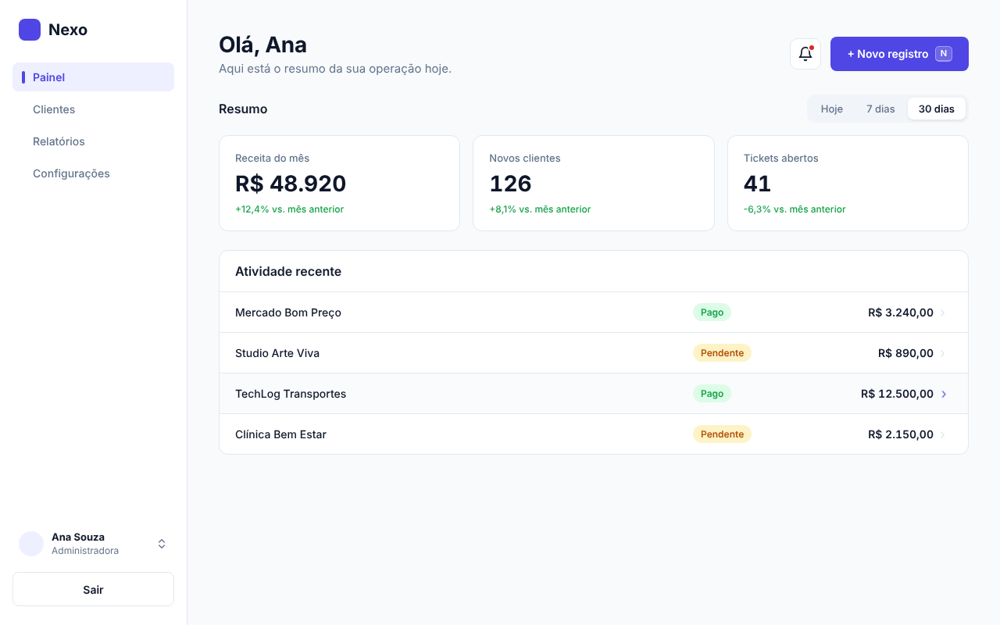
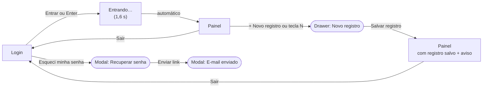
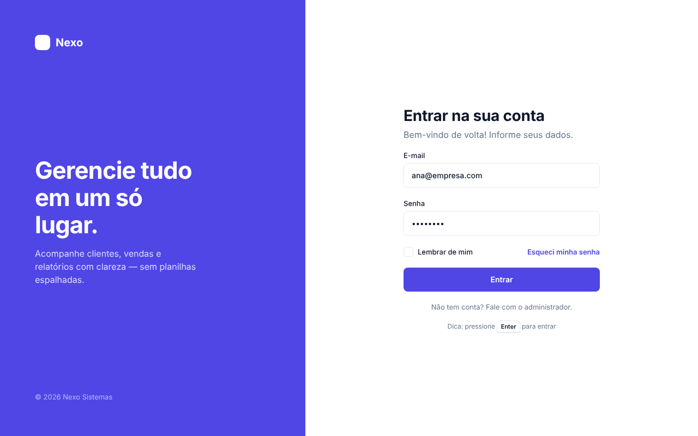
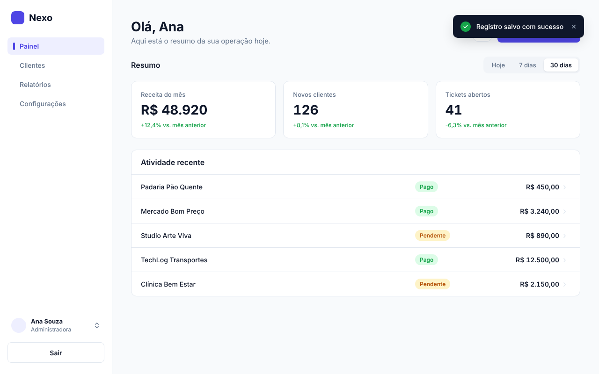
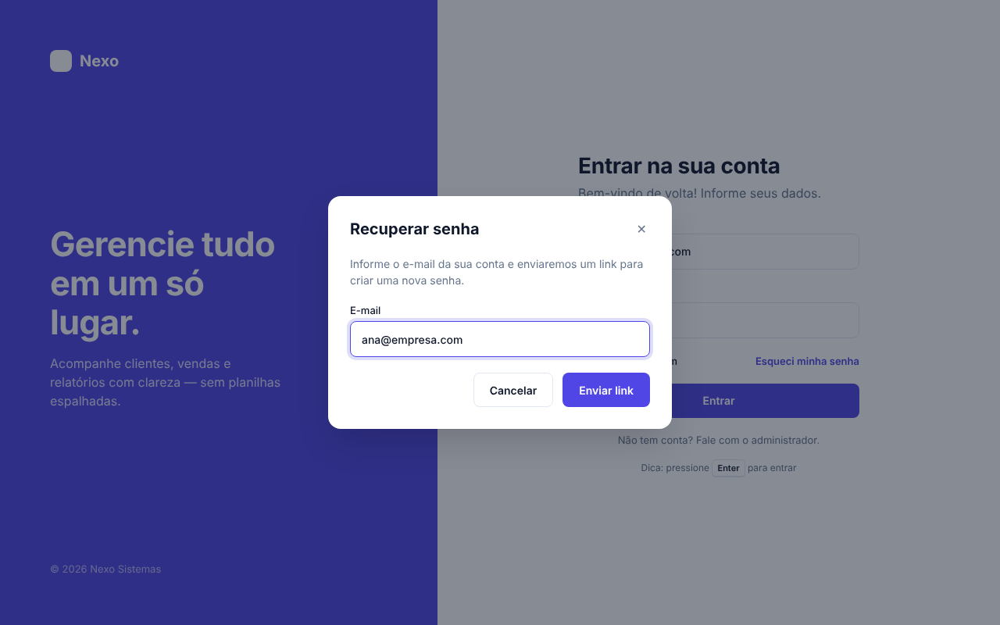
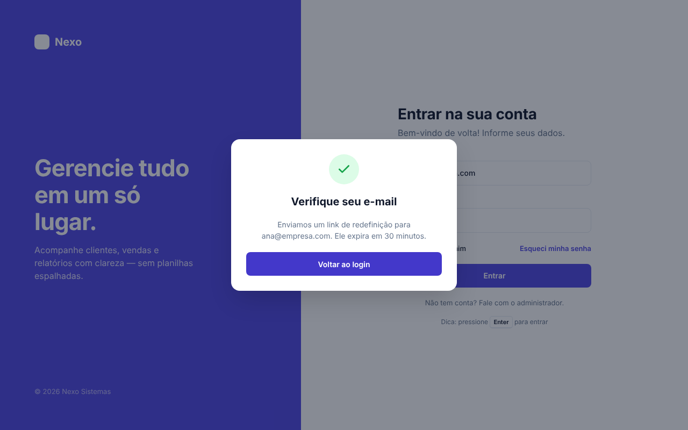
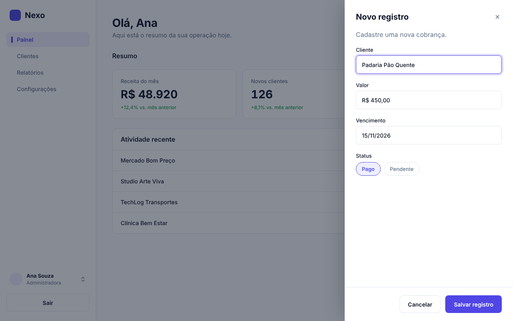
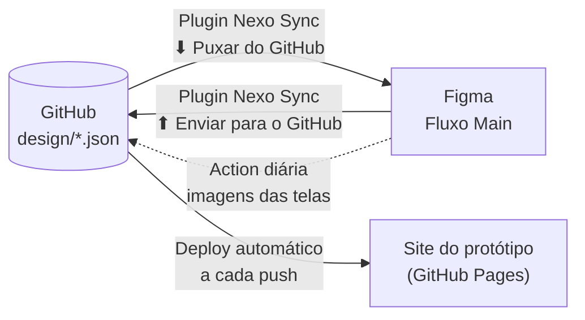

<div align="center">



# Nexo · Fluxo Main

**Protótipo navegável de um sistema de gestão (login + painel), desenhado no Figma e sincronizado com este repositório.**

[](https://SEU-USUARIO.github.io/nexo-fluxo-main/web/)
[](https://www.figma.com/proto/T00OQ9bu7XArjEOzYAA5xP/Fluxo-main?node-id=4-2&starting-point-node-id=4%3A2&scaling=scale-down&hide-ui=1)
[](https://github.com/SEU-USUARIO/nexo-fluxo-main/actions/workflows/pages.yml)

</div>

---

## Links rápidos

| Para quê | Link |
|---|---|
| Apresentar ao cliente (site, sem Figma) | https://SEU-USUARIO.github.io/nexo-fluxo-main/web/ |
| Apresentar no Figma (modo apresentação) | [Protótipo no Figma](https://www.figma.com/proto/T00OQ9bu7XArjEOzYAA5xP/Fluxo-main?node-id=4-2&starting-point-node-id=4%3A2&scaling=scale-down&hide-ui=1) |
| Editar o design | [Arquivo no Figma](https://www.figma.com/design/T00OQ9bu7XArjEOzYAA5xP/Fluxo-main) |
| Abrir na sua máquina | `git clone https://github.com/SEU-USUARIO/nexo-fluxo-main.git && cd nexo-fluxo-main && npm start` |

## Rodando na sua máquina

Você só precisa do [Node.js](https://nodejs.org) 18 ou mais novo. Não há dependências para instalar.

```bash
git clone https://github.com/SEU-USUARIO/nexo-fluxo-main.git
cd nexo-fluxo-main
npm start
```

O navegador abre sozinho em `http://localhost:4321/web/`. Para usar outra porta: `PORT=5000 npm start`.

> Abrir o `web/index.html` com duplo clique não funciona, porque o navegador bloqueia a leitura dos arquivos `design/*.json` fora de um servidor. Use o `npm start`.

## O fluxo



| Tela | Imagem |
|---|---|
| Login |  |
| Entrando (carregamento) |  |
| Painel |  |
| Painel com registro salvo |  |
| Recuperar senha |  |
| E-mail enviado |  |
| Novo registro |  |

O roteiro completo de apresentação, com todas as interações, está em **[docs/interacoes.md](docs/interacoes.md)**.

## Sincronização Git ⇄ Figma

Os **textos** e as **cores** do protótipo vivem em dois arquivos, que são a fonte única da verdade:

| Arquivo | O que controla |
|---|---|
| [`design/tokens.json`](design/tokens.json) | Paleta de cores (16 tokens), raios de borda e fonte |
| [`design/content.json`](design/content.json) | Todos os textos: login, painel, métricas por período, tabela, notificações |



- **Mudou no Git?** Edite o JSON, faça o commit e, no Figma, rode **Plugins → Development → Nexo Sync → ⬇ Puxar do GitHub**. O site se atualiza sozinho.
- **Mudou no Figma?** Rode **⬆ Enviar para o GitHub** no mesmo plugin. Ele faz o commit e o site se atualiza.

Passo a passo de instalação do plugin, como gerar os tokens e o que é e o que não é sincronizado: **[docs/sincronizacao.md](docs/sincronizacao.md)**.

## Estrutura

```
nexo-fluxo-main/
├── design/
│   ├── tokens.json          # cores, raios, fonte (fonte da verdade)
│   └── content.json         # textos das telas (fonte da verdade)
├── web/                     # protótipo navegável (HTML + CSS + JS puro)
├── figma-plugin/            # plugin "Nexo Sync" (GitHub ⇄ Figma)
├── scripts/
│   ├── serve.mjs            # npm start
│   ├── validate.mjs         # npm run validate
│   └── figma-snapshot.mjs   # npm run snapshot (exporta PNGs do Figma)
├── docs/
│   ├── interacoes.md        # roteiro de apresentação
│   ├── sincronizacao.md     # como o Git ⇄ Figma funciona
│   ├── design-system.md     # tokens e componentes
│   └── screens/             # imagens das telas
├── .github/workflows/
│   ├── pages.yml            # publica o site a cada push
│   └── figma-snapshot.yml   # atualiza as imagens a partir do Figma
└── publicar.sh / .ps1       # cria o repositório no GitHub (uso único)
```

## Comandos

| Comando | O que faz |
|---|---|
| `npm start` | Sobe o protótipo em `localhost:4321` e abre o navegador |
| `npm run validate` | Confere se `design/*.json` estão completos (também roda antes de cada publicação) |
| `FIGMA_TOKEN=… npm run snapshot` | Baixa do Figma as imagens atualizadas das telas para `docs/screens/` |

## Design system

Documentação dos tokens de cor, tipografia e dos componentes interativos do Figma: **[docs/design-system.md](docs/design-system.md)**.

---

<sub>Desenhado no Figma · Protótipo em HTML, CSS e JavaScript sem dependências · Licença MIT</sub>
